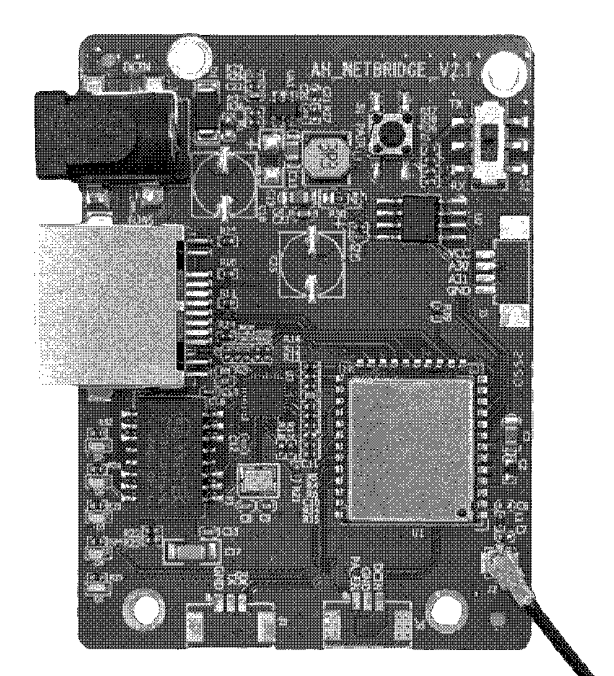
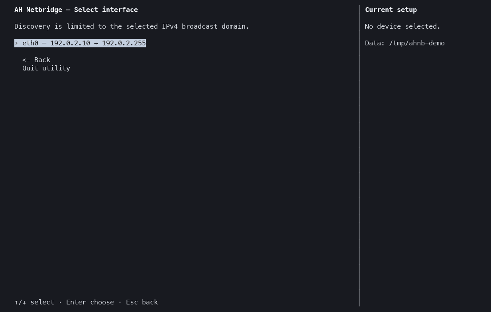

This is a configuration utility for TaiXin Wi-Fi HaLow bridges.



AH_NETBRIDGE_V2.1 — the board the utility was built for and tested on.
Compatibility with other TaiXin-based HaLow devices is not guaranteed.

## Dependencies

| Dependency | Use |
| --- | --- |
| Python 3.11 or later, with `curses` | The utility is run with it. |
| C11 compiler and `make` | The native protocol library is built with them. |
| `uv` (optional) | The utility is installed and run with it. Without `uv`, `venv` and `pip` are used. |

No third-party Python packages are required.

macOS (Homebrew):

```sh
xcode-select --install
brew install python uv
```

Debian and Ubuntu:

```sh
sudo apt install build-essential python3 python3-venv pipx
pipx install uv
```

Fedora:

```sh
sudo dnf install gcc make python3 uv
```

Arch Linux:

```sh
sudo pacman -S base-devel python uv
```

The host must be connected to the same layer-2 segment as the bridge.
UDP port 56789 must be open in the host firewall.

## Quickstart

The `ahnb` command is installed with:

```sh
make install
ahnb --help
```

Snapshots, saved configurations and `shared.psk` are kept in `~/.local/state/ah-netbridge`.
A different folder can be set with `--data-root DIR`.

## Usage



The TUI is started with:

```sh
make run
```

In the TUI, AT commands can be manually dispatched via `Manual AT command dispatch` in the main menu.

AT commands can also be sent using the CLI.
In the examples, `eth0` and the MAC are placeholders for the interface and the bridge.

```sh
ahnb interfaces                                    # eligible interfaces
ahnb scan -i eth0                                  # bridges on eth0
ahnb show -i eth0 -m 02:00:5e:10:00:01             # current configuration
ahnb commands --class query                        # catalogue queries
ahnb at -i eth0 -m 02:00:5e:10:00:01 'AT+RSSI' 'AT+T_SENSOR=?'
ahnb at -i eth0 -m 02:00:5e:10:00:01 --json 'AT+WNBCFG'
ahnb at -i eth0 -m 02:00:5e:10:00:01 --dry-run --write 'AT+TXPOWER=14'
ahnb at -i eth0 -m 02:00:5e:10:00:01 --write 'AT+TXPOWER=14'
ahnb at -i eth0 -m 02:00:5e:10:00:01 --write --file commands.txt
ahnb shell -i eth0 -m 02:00:5e:10:00:01            # interactive prompt
```

| Command class | Example | Flag |
| --- | --- | --- |
| Query | `AT+RSSI` | None |
| Setting | `AT+TXPOWER=14` | `--write` |
| Action or unknown | `AT+RESET` | `--dangerous` |

A command without the correct flag is not sent.
With `--dry-run`, the command is shown and not sent.
A snapshot is made before the first change.
All options are shown by `ahnb --help` and `ahnb COMMAND --help`.

## Features

- Discovery of the bridges on the selected interface. The exact MAC is selected by the operator.
- SSID and PSK changes (WPA-PSK). A random 256-bit PSK can be generated and kept in `shared.psk`.
- Radio changes: channel list, bandwidth and TX power, set from the menus or from a regional preset (CE, FCC, MIC).
- Read-back verification of each change. A partial change is reported.
- A device snapshot before the first change, and a restore from the snapshot.
- Named backups of the full configuration.
- Manual AT command dispatch in the TUI and in the CLI, with a catalogue of 186 TaiXin AT commands.
- Catalogue search by typed letters. With Ctrl+G, the command is edited in `$EDITOR`.
- Safety classes for manual commands. A query is sent immediately. A setting must be confirmed. An action must be confirmed with its command name.
- The PSK is never shown on the screen or in the replies.
- Scriptable CLI commands: `interfaces`, `scan`, `show`, `commands`, `at` and `shell`, with JSON output and exit codes.

## Layout

```text
include/taixinnet.h         C interface of the native library
native/taixinnet.c          NetAT protocol: framing, queries, writes, verification
src/ah_netbridge/
  cli.py                    Command entry point and CLI commands
  tui.py                    Terminal interface
  dispatch.py               Checks for manual AT commands (CLI and TUI)
  catalog.py                AT command catalogue: load, classify, redact
  catalog/                  TaiXin AT command catalogue (TOML)
  native.py                 Python bindings for the native library
  network.py                Interface list and bridge discovery
  storage.py                Snapshots, saved configurations, shared.psk
  presets.py                Radio preset loader
  presets/                  Regional radio presets (TOML)
docs/board.png, demo.gif    README images
Makefile                    Build, run and install
setup.py, pyproject.toml    Python package
```
